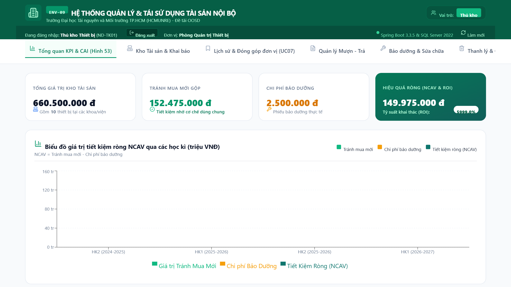

# ENV-09: Hệ thống chia sẻ và tái sử dụng tài sản nội bộ

Đồ án cuối kỳ môn **Phương pháp phát triển phần mềm hướng đối tượng (OOSD)**, Trường Đại học Tài nguyên và Môi trường TP. Hồ Chí Minh (HCMUNRE).

| | |
|---|---|
| Sinh viên thực hiện | Trần Nguyên |
| Mã số sinh viên | 1250080121 |
| Lớp | 12_ĐH_CNPM2 |
| Giảng viên hướng dẫn | ThS. Phạm Trọng Huynh |

## Giới thiệu

Các khoa, phòng trong trường có nhiều thiết bị chuyên dụng (máy đo môi trường, máy trắc địa, máy chiếu, máy trạm…) thường nhàn rỗi trong khi đơn vị khác lại lập dự toán mua mới. Hệ thống số hóa quy trình **khai báo tài sản nhàn rỗi → đặt mượn → xét duyệt → bàn giao → thu hồi, đánh giá hao mòn → bảo dưỡng / thanh lý**, đồng thời tính **Chỉ số tránh mua mới (CAI)** và **Giá trị tiết kiệm ròng (NCAV)** để đo hiệu quả chia sẻ.

- 4 vai trò: Nhân viên (đại diện khoa/phòng), Thủ kho, Lãnh đạo đơn vị, Quản trị viên.
- 17 Use Case, 21 quy tắc nghiệp vụ (BR01 - BR21) và 2 quy tắc bổ sung (BR-EXTRA-01, BR-EXTRA-02).
- Vòng đời tài sản 7 trạng thái: Mới → Sẵn sàng chia sẻ → Đang mượn → Cần bảo dưỡng → Đang bảo dưỡng → Đề xuất thanh lý → Đã thanh lý.
- Tiến trình tự động lúc 00:05 hằng ngày: bật cờ quá hạn, tự hủy phiếu đã duyệt nhưng không nhận máy.

## Công nghệ

| Tầng | Công nghệ |
|---|---|
| Giao diện | React 18, Vite 5, Tailwind CSS, Recharts, Axios |
| Máy chủ | Java 21, Spring Boot 3.3.5, Spring Data JPA, SimpleJdbcCall, Lombok, springdoc-openapi |
| Cơ sở dữ liệu | Microsoft SQL Server 2022: 14 bảng, 14 thủ tục, 3 trigger, 5 view, 7 sequence |

## Cấu trúc thư mục

```
├── database/
│   └── ENV09_QuanLyTaiSan.sql        Script tạo CSDL, thủ tục, trigger, view và dữ liệu mẫu
├── quanlytaisan/                     Mã nguồn ứng dụng
│   ├── src/main/java/...             Backend Spring Boot (controller, service, dao, entity, config)
│   ├── src/main/resources/           Cấu hình và giao diện đã build (static/)
│   └── frontend/                     Mã nguồn giao diện React
├── So_do/
│   ├── *.drawio                      File nguồn sơ đồ (mở bằng draw.io / diagrams.net)
│   └── PNG/                          Ảnh xuất của sơ đồ và ảnh chụp giao diện
│       ├── UseCase/  Lop/  TrangThai/  Activity/  Sequence/
│       ├── ERD/  KienTruc/  ToChuc/
│       └── GiaoDien/                 21 ảnh chụp màn hình dùng trong báo cáo
└── TaiLieu/
    ├── BANG_BIEU.md                  Toàn bộ bảng biểu trong báo cáo (69 bảng + 18 bảng Use Case)
    ├── DANH_MUC_HINH.md              Đối chiếu Hình 1 - 59 trong báo cáo với file PNG và .drawio
    └── QUY_TAC_NGHIEP_VU.md          21 quy tắc nghiệp vụ, đặc tả lớp và 14 bảng CSDL
```

## Đối chiếu với báo cáo Word

- **Hình:** [TaiLieu/DANH_MUC_HINH.md](TaiLieu/DANH_MUC_HINH.md) liệt kê từng hình trong báo cáo kèm đường dẫn tới ảnh PNG và file nguồn draw.io.
- **Bảng biểu:** [TaiLieu/BANG_BIEU.md](TaiLieu/BANG_BIEU.md) chứa nội dung toàn bộ bảng trong báo cáo, giữ đúng số và tên bảng.
- **Cơ sở dữ liệu:** cấu trúc 14 bảng (Bảng 49 - 62) và các thủ tục (Bảng 65) được cài đặt trong [database/ENV09_QuanLyTaiSan.sql](database/ENV09_QuanLyTaiSan.sql).

## Hướng dẫn cài đặt và chạy

### 1. Yêu cầu

- **JDK 21** (không dùng JDK 24 trở lên: phiên bản Lombok của dự án chưa hỗ trợ, sẽ lỗi khi biên dịch)
- Maven 3.9+ (hoặc dùng `mvnw` đi kèm)
- Node.js 18+ (chỉ cần nếu muốn sửa và build lại giao diện)
- SQL Server 2019/2022 bật xác thực SQL Server, cổng 1433

### 2. Tạo cơ sở dữ liệu

Mở `database/ENV09_QuanLyTaiSan.sql` bằng SQL Server Management Studio rồi chạy (F5), hoặc dùng dòng lệnh:

```bash
sqlcmd -S localhost -U sa -P <mat_khau> -C -f 65001 -i database/ENV09_QuanLyTaiSan.sql
```

> Script sẽ **xóa và tạo lại** CSDL `ENV09_QuanLyTaiSan`, kèm dữ liệu mẫu.

### 3. Khai báo tài khoản CSDL

Mật khẩu CSDL không được lưu trong mã nguồn. Chọn một trong hai cách:

- **Cách 1:** chép `quanlytaisan/src/main/resources/application-secret.properties.example` thành `application-secret.properties` (cùng thư mục) rồi điền tài khoản, mật khẩu SQL Server.
- **Cách 2:** đặt biến môi trường `DB_USERNAME`, `DB_PASSWORD` (và `DB_URL` nếu CSDL không ở `localhost:1433`).

### 4. Chạy ứng dụng

```bash
cd quanlytaisan
./mvnw spring-boot:run
```

Mở trình duyệt tại **http://localhost:8080**. Giao diện đã được build sẵn vào `src/main/resources/static`, nên không cần chạy Node.js. Tài liệu API (Swagger): http://localhost:8080/swagger-ui.html

Muốn đóng gói thành file JAR:

```bash
cd quanlytaisan
./mvnw clean package -DskipTests
java -jar target/quanlytaisan-0.0.1-SNAPSHOT.jar
```

### 5. (Tùy chọn) Sửa và build lại giao diện

```bash
cd quanlytaisan/frontend
npm install
npm run dev      # chạy thử ở http://localhost:5173, gọi API sang cổng 8080
npm run build    # build vào ../src/main/resources/static
```

## Tài khoản dùng thử

Các tài khoản dưới đây có sẵn trong dữ liệu mẫu của script SQL, chỉ dùng để chạy thử:

| Vai trò | Tên đăng nhập | Mật khẩu |
|---|---|---|
| Quản trị viên | `admin` | `Admin@123` |
| Thủ kho | `thukho` | `ThuKho@123` |
| Nhân viên - Khoa CNTT | `gv_cntt` | `User@123` |
| Nhân viên - Khoa Môi trường | `gv_mt` | `User@123` |
| Lãnh đạo đơn vị | `lanhdao` | `User@123` |

## Sơ đồ phân tích - thiết kế

| Sơ đồ | File nguồn | Ảnh |
|---|---|---|
| Use Case | `So_do/HE_THONG_SO_DO_USE_CASE.drawio` | `So_do/PNG/UseCase/` |
| Lớp (phân tích, thiết kế) | `So_do/HE_THONG_SO_DO_LOP.drawio` | `So_do/PNG/Lop/` |
| Trạng thái (Tài sản, Phiếu mượn) | `So_do/HE_THONG_SO_DO_TRANG_THAI.drawio` | `So_do/PNG/TrangThai/` |
| Hoạt động (17 Use Case) | `So_do/HE_THONG_SO_DO_ACTIVITY_DIAGRAM.drawio` | `So_do/PNG/Activity/` |
| Tuần tự (7 Use Case chính) | `So_do/HE_THONG_SO_DO_SEQUENCE_DIAGRAM.drawio` | `So_do/PNG/Sequence/` |
| ERD cơ sở dữ liệu | `So_do/HE_THONG_SO_DO_ERD_CSDL.drawio` | `So_do/PNG/ERD/` |
| Kiến trúc hệ thống | `So_do/HE_THONG_SO_DO_KIEN_TRUC.drawio` | `So_do/PNG/KienTruc/` |
| Tổ chức | `So_do/HE_THONG_SO_DO_TO_CHUC.drawio` | `So_do/PNG/ToChuc/` |


